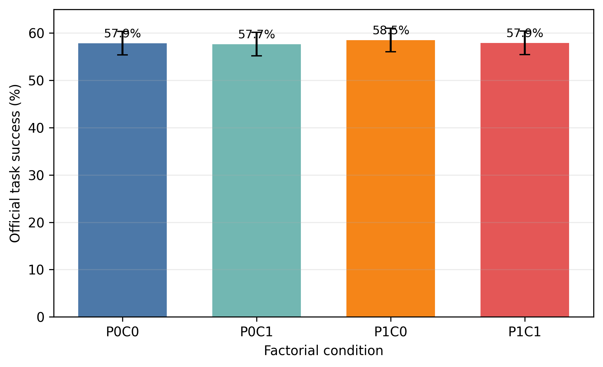
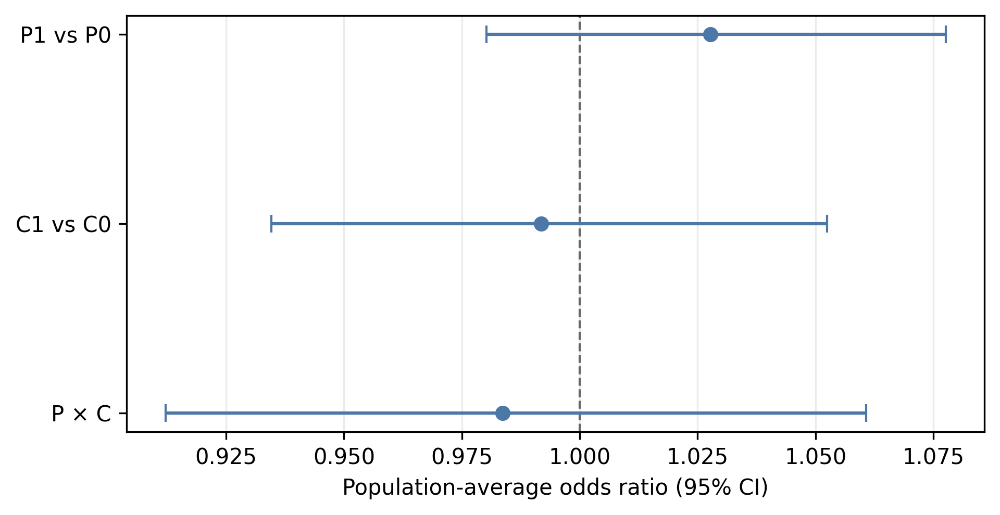
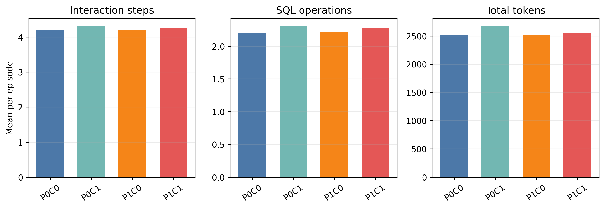
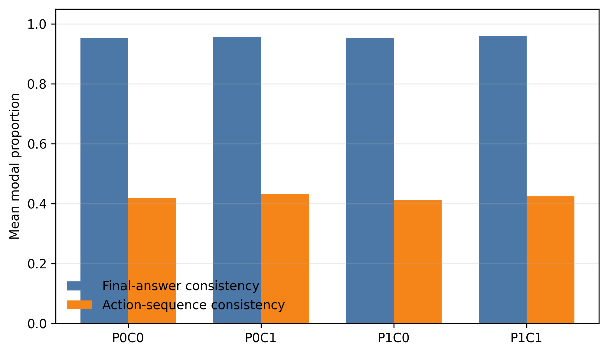

# DBBench Full Factorial Results

## Scope and Analysis Dataset

The completed DBBench experiment contains 6,000 episodes: 300 tasks, four
factorial conditions, and five repetitions per task and condition. All episode
identities were unique, every task-condition group contained five observations,
and the same task indices were used throughout. The model snapshot was
`gpt-5-2025-08-07`.

The original DBBench mutation evaluator was incompatible with the database
image because the expected `MD5()` function was unavailable. Consequently, the
original INSERT and UPDATE aggregate scores were not interpreted as agent
outcomes. The 4,000 mutation trajectories were rescored by replaying their
originally accepted SQL actions against the frozen initial tables and computing
the historical table fingerprint in Python. The remaining 2,000 query outcomes
were retained from the original evaluator. No additional language-model calls
were used during recovery. The resulting 6,000-row analysis dataset contained
no missing official outcomes and was reproduced with SHA-256 checksum
`a3c2f12b014ae0b3e90bde1a57ec30635035217da13f0047e1d33f013a0843f8`.

## Official Task Success

Mean official success ranged from 57.7% to 58.5% across the four conditions:

| Condition | Episodes | Success | 95% descriptive CI |
| --- | ---: | ---: | ---: |
| P0C0 | 1,500 | 57.9% | 55.4%--60.4% |
| P0C1 | 1,500 | 57.7% | 55.2%--60.2% |
| P1C0 | 1,500 | 58.5% | 56.0%--61.0% |
| P1C1 | 1,500 | 57.9% | 55.4%--60.4% |

Task-clustered logistic generalized estimating equations did not identify a
clear population-average effect of P1, C1, or their interaction on official
success. The estimated odds ratios were 1.028 for P1 versus P0 (95% CI
0.980--1.078, p=0.257), 0.992 for C1 versus C0 (95% CI 0.935--1.053,
p=0.787), and 0.984 for the interaction (95% CI 0.912--1.061, p=0.669).
These intervals are compatible with small effects in either direction and do
not establish exact equivalence between conditions.

### Random-intercept sensitivity analysis

The planned task-random-intercept logistic model was fitted to the same
corrected 6,000 episodes as a sensitivity analysis. It was not used to replace
the primary GEE after the results were observed. The model estimated an odds
ratio of 1.204 for P1 versus P0 (95% CI 0.825--1.756, p=0.336), 0.946 for C1
versus C0 (95% CI 0.649--1.379, p=0.773), and 0.895 for the interaction (95%
CI 0.525--1.525, p=0.682).

All three GLMM coefficients had the same direction as their primary GEE
counterparts. Their conditional odds ratios were farther from one and their
confidence intervals were wider, but neither analysis identified a clear P,
C, or interaction effect on official success. Logistic GEE describes the
marginal association after averaging over unmodeled task heterogeneity,
whereas the random-intercept GLMM describes the association conditional on a
task-specific random effect. The two sets of odds ratios therefore address
different model formulations and are not expected to be numerically identical
(Muff, Held, and Keller, 2016;
https://doi.org/10.1111/2041-210X.12623).





## Trajectory and Resource Outcomes

C1 was associated with modest increases in several trajectory-resource
measures after Benjamini--Hochberg correction across the secondary tests. The
estimated C1 effect corresponded to 2.8% more interaction steps (95% CI
0.8%--4.8%, adjusted p=0.049), 4.6% higher input-token use (95% CI
1.7%--7.7%, adjusted p=0.044), and 4.0% higher total-token use (95% CI
1.3%--6.8%, adjusted p=0.044). No other secondary factorial contrast met the
prespecified false-discovery threshold of 0.05.

The observed differences should be interpreted as effects of the implemented
format-checking and repair policy as a whole. The analysis does not isolate
prompt-format checking from the additional responses generated when repair is
attempted. Repair attempts occurred in 36 C1 episodes, and 33 of those attempts
produced a parser-accepted replacement action. Repair success therefore
describes format recovery, not task correctness.



## Repeated-Output Variability

Final answers showed high modal consistency across the five repeated
task-condition observations, with means ranging from 0.953 to 0.961. Exact
normalized action sequences showed lower modal consistency, with means between
0.412 and 0.431. Mean final-answer entropy ranged from 0.117 to 0.141 bits,
whereas mean action-sequence entropy ranged from 1.713 to 1.760 bits.

This contrast shows that equivalent or repeated final outcomes can arise from
different action trajectories. The entropy and modal-consistency measures are
empirical summaries of five repeated observations. They are not estimates of
reliability, hallucination probability, semantic uncertainty, or validated
general behavioral stability. No inferential factorial model was prespecified
for these group-level variability summaries, so differences among conditions
remain descriptive.



## Explanatory Value of Trajectory Measures

In five-fold task-grouped cross-validation, the condition-only success model
had mean ROC AUC 0.655 and mean log loss 0.644. Adding the prespecified
trajectory measures increased mean ROC AUC to 0.758 and reduced mean log loss
to 0.579. The corresponding mean differences were +0.103 in ROC AUC and -0.064
in log loss. Each fold held out all observations from 60 tasks. Log loss
improved in four of the five folds, which indicates useful but non-uniform
generalization across task subsets.

A nested task-fixed likelihood comparison also favored the
trajectory-augmented model (likelihood-ratio statistic 77.78, 7 degrees of
freedom, p<0.001). These results support the claim that recorded trajectory
features contain information about task success beyond the condition labels.
They do not imply that changing a trajectory metric would causally change
success, because trajectory length, token use, and errors may themselves be
consequences of task difficulty or failure.

## Diagnostics and Limitations

All reported inferential models converged and produced finite estimates,
confidence intervals, and p-values. Count-model dispersion ratios supported
Poisson generalized estimating equations for interaction steps and SQL
operations. Token distributions were strongly right-skewed and were analyzed
on the `log1p` scale with task-clustered uncertainty. Invalid-action occurrence
contained no events and was therefore reported descriptively rather than
modeled. Repair occurrence was analyzed only within C1 because repair was
structurally unavailable under C0.

The sensitivity GLMM converged with `bobyqa` (optimizer code 0), produced no
convergence messages or model warnings, and was not singular at tolerance
0.0001. The maximum absolute gradient was 0.000013, and the minimum Hessian
eigenvalue was 1.786. The task-random-intercept variance was 126.471
(SD 11.246), indicating substantial modeled task-level heterogeneity on the
conditional log-odds scale. R 4.6.1 and `lme4` 2.0.6 were used with ten-point
adaptive Gauss--Hermite quadrature, `bobyqa`, a maximum of 200,000 function
evaluations, two-sided 95% Wald confidence intervals, and two-sided
asymptotic Wald z tests. Full diagnostics and the direct GEE comparison are
stored in `dbbench_success_glmm_sensitivity.json`.

Several limitations remain. The mutation outcomes depend on deterministic
post-experiment replay, although replay uses the frozen initial data and the
actions already accepted during the original episodes. Generalized estimating
equations estimate population-average rather than task-specific conditional
effects. The descriptive confidence intervals in the condition table do not
model repeated-task dependence and are included for visualization rather than
factorial inference. Results concern one model snapshot and one benchmark
environment; generalization to other models, environments, and deployed agents
requires separate evidence.

## Reproduction

The technical results are regenerated from ignored analysis artifacts using:

```bash
python -m scripts.build_dbbench_results_report \
  --analysis-dir results/dbbench_factorial_analysis \
  --stability results/dbbench_factorial_stability_metrics.csv \
  --figure-dir thesis_protocol/figures \
  --table-dir results/dbbench_factorial_publication_tables
```

The random-intercept sensitivity analysis is reproduced in the pinned R
environment using:

```bash
docker build \
  -f analysis/r-glmm/Dockerfile \
  analysis/r-glmm \
  -t trajectorybench/r-glmm:4.6.1

docker run --rm \
  -v "$PWD:/work" \
  -w /work \
  trajectorybench/r-glmm:4.6.1 \
  Rscript scripts/fit_dbbench_success_glmm.R \
    results/dbbench_factorial_rescored_episode_metrics.csv \
    results/dbbench_factorial_analysis/factorial_effects.csv \
    thesis_protocol/dbbench_success_glmm_sensitivity.json
```

The input dataset must have SHA-256 checksum
`a3c2f12b014ae0b3e90bde1a57ec30635035217da13f0047e1d33f013a0843f8`.

The underlying statistical outputs and publication tables remain generated
artifacts under `results/`. The figure PDFs and PNGs are retained with the
technical report so the exact reviewed visualizations can be used in later
reporting.
